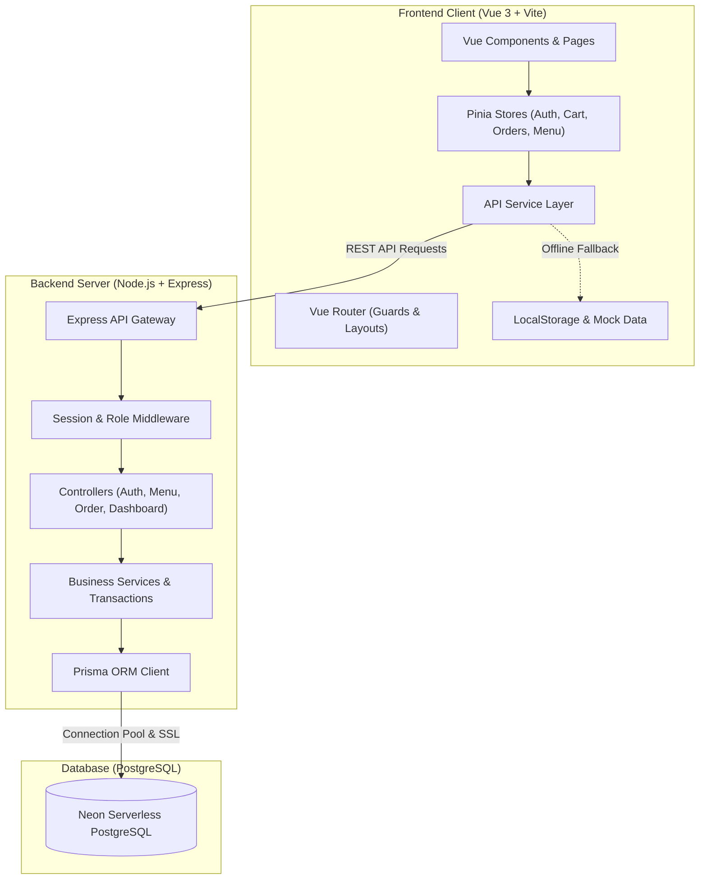
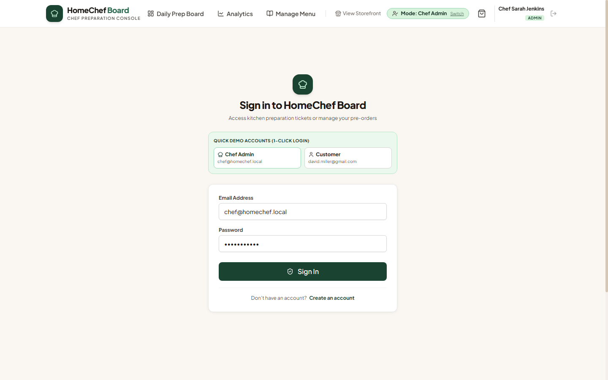
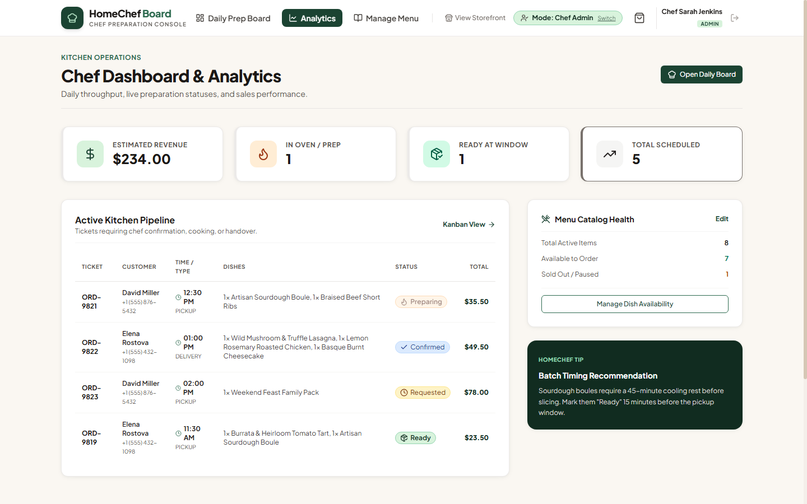
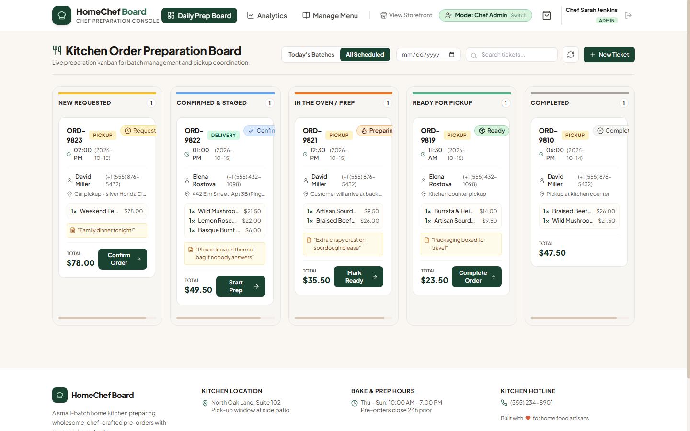
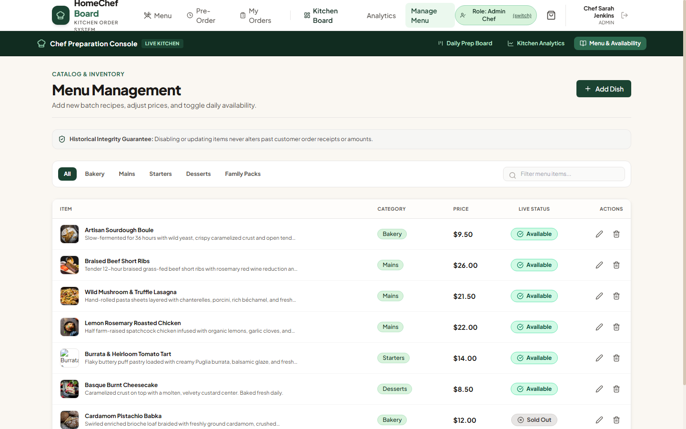
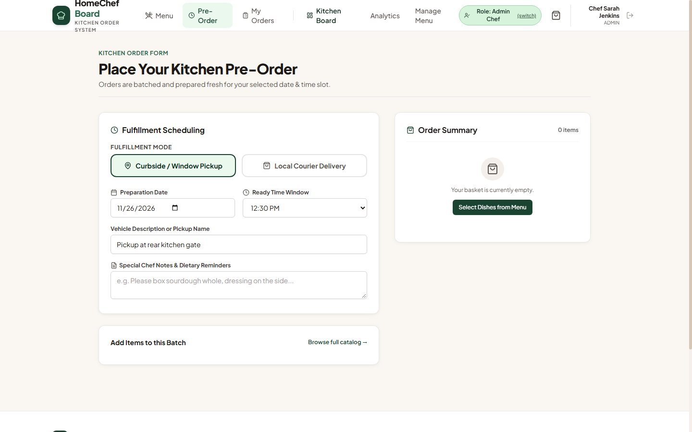
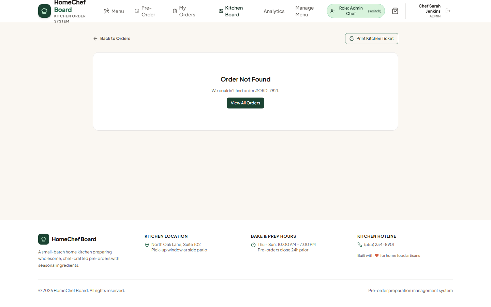

# HomeChef Board 🍳

[](https://vuejs.org/)
[](https://vitejs.dev/)
[](https://www.typescriptlang.org/)
[](https://expressjs.com/)
[](https://www.prisma.io/)
[](https://neon.tech/)
[](https://tailwindcss.com/)
[](LICENSE)

> A modern, full-stack kitchen order preparation and pre-order management system tailored for home-based culinary entrepreneurs, artisanal micro-bakers, and chef pre-order operations.

> [!IMPORTANT]
> ### 🔑 Quick Demo Login Credentials
> The system comes pre-configured with ready-to-test accounts. You can also use the **1-Click Quick Demo Login** buttons on the sign-in page (`/login`) or the **Mode Switcher** in the top navigation bar.
> 
> | Role | Persona / Name | Email | Password | Access & Portals |
> |---|---|---|---|---|
> | 🍳 **Chef Admin** | Chef Sarah Jenkins | `chef@homechef.local` | `password123` | • Daily Kitchen Prep Kanban (`/admin/daily-board`)<br>• Throughput Analytics (`/admin/dashboard`)<br>• Menu Management & Availability (`/admin/menu-management`) |
> | 🥐 **Customer (User 1)** | David Miller | `david.miller@gmail.com` | `password123` | • Artisan Menu Pre-Orders (`/order`)<br>• Order Tracking & Receipts (`/my-orders`)<br>• Star Rating & Review Submissions |
> | 🥐 **Customer (User 2)** | Elena Rostova | `elena.rostova@outlook.com` | `password123` | • Local Delivery Pre-Orders (`/order`)<br>• Printable Thermal Ticket Slips (`/orders/:id`) |

---

## 📑 Table of Contents

- [🌟 Features & Capabilities](#-features--capabilities)
- [📄 Product Requirements Document (PRD)](#-product-requirements-document-prd)
- [🏗️ System Architecture & Workflow](#️-system-architecture--workflow)
- [🛠️ Technology Stack](#️-technology-stack)
- [📁 Monorepo Project Structure](#-monorepo-project-structure)
- [🚀 Quick Start Guide](#-quick-start-guide)
  - [1. Prerequisites](#1-prerequisites)
  - [2. Installation](#2-installation)
  - [3. Neon PostgreSQL & Prisma Setup](#3-neon-postgresql--prisma-setup)
  - [4. Running the Development Servers](#4-running-the-development-servers)
- [📸 Application Screenshots Gallery](#-application-screenshots-gallery)
- [📡 REST API Reference](#-rest-api-reference)
- [🗄️ Database Schema & Data Integrity](#️-database-schema--data-integrity)
- [👥 Demo Accounts & Testing](#-demo-accounts--testing)
- [📽️ Demo Presentation & Internship Submission](#️-demo-presentation--internship-submission)
- [🚢 Production Deployment](#-production-deployment)
- [📄 License](#-license)

---

## 📄 Product Requirements Document (PRD)

The complete internship project specification is available in both PDF and Markdown formats, created to the TriFin-Loop R&D Software Engineering Internship standards:
- 📕 **Official PRD PDF**: [HomeChef_Board_PRD_v1.0.pdf](HomeChef_Board_PRD_v1.0.pdf)
- 📝 **PRD Markdown Source**: [docs/HomeChef_Board_PRD_v1.0.md](docs/HomeChef_Board_PRD_v1.0.md)
- 🌐 **Formatted Web View**: [docs/HomeChef_Board_PRD_v1.0.html](docs/HomeChef_Board_PRD_v1.0.html)

Includes all 9 sections: Problem & Users, Scope & MVP Inventory, User Stories & Process Flow, Functional Requirements (FR-01 to FR-05), Non-Functional Targets (NFR-01 to NFR-06), UX Screen Wireframes, Architecture & Database Design, Test Plan & Traceability Matrix, and Execution Plan.

---

---

## 🌟 Features & Capabilities

### 🍳 For Chefs & Kitchen Managers (Admin)
- **Daily Kitchen Prep Board (Kanban Pipeline)**: Real-time visual tracking of orders through 6 progressive stages:
  `REQUESTED` ➔ `CONFIRMED` ➔ `PREPARING` ➔ `READY` ➔ `COMPLETED` *(or `CANCELLED`)*
- **1-Click Stage Transitions**: Advance order tickets with a single click as dishes move into the oven, to packaging, and to the pickup counter.
- **Kitchen Throughput Analytics**: Live metrics tracking today's gross revenue, active in-oven prep batches, window-ready orders, and fulfillment breakdown.
- **Menu Catalog Management**: Add signature dishes, adjust prices, edit descriptions, upload food imagery, and instantly toggle between **"Available"** and **"Sold Out"** to prevent kitchen overbooking.

### 🥐 For Customers & Foodies
- **Frictionless Pre-Order Scheduling**: Browse artisanal offerings, select fulfillment date and pickup/delivery time slots, and specify dietary or buzzer/vehicle notes.
- **Order Tracking & Digital Receipts**: Follow the live preparation status of orders from confirmation through ready-for-pickup.
- **Immutable Historical Receipts**: Dish names and unit prices are snapshotted at moment of purchase, preserving past receipt accuracy regardless of future menu adjustments.

### ⚡ Developer Experience & Dual-Mode Architecture
- **Dual-Mode Persistence**: Operates as a full-stack system connected to Neon PostgreSQL, or runs standalone in the browser with automatic fallback to `localStorage` and realistic demo mock datasets.
- **1-Click Demo Role Switcher**: Interactive switcher directly in the navbar allows instantaneous toggling between **Chef Admin** and **Customer** personas without re-authenticating.

---

## 🏗️ System Architecture & Workflow



---

## 🛠️ Technology Stack

| Domain | Technology | Version | Purpose |
|---|---|---|---|
| **Frontend Framework** | Vue 3 | `^3.5.13` | Reactive UI using Composition API & `<script setup>` |
| **Build & Dev Tool** | Vite | `^6.1.1` | Ultra-fast HMR and optimized production bundling |
| **Language** | TypeScript | `^5.7.3` | End-to-end type safety across client and server |
| **Styling & Theme** | Tailwind CSS | `^3.4.17` | Kitchen-warm aesthetic (`cream`, `terracotta`, `sage`) |
| **Icons** | Lucide Vue Next | `^0.475.0` | Crisp modern iconography for orders, timers, and chefs |
| **State Management** | Pinia | `^3.0.1` | Modular state for authentication, cart, orders, and menu |
| **Client Routing** | Vue Router | `^4.5.0` | History mode navigation with role-based layout switches |
| **Backend Runtime** | Node.js + Express | `^4.21.2` | RESTful API server with TypeScript execution (`tsx`) |
| **Database** | Neon PostgreSQL | Serverless | Cloud-native serverless PostgreSQL instance |
| **ORM** | Prisma ORM | `^6.4.1` | Schema migrations, query builder, and relations |
| **Data Validation** | Zod | `^3.24.2` | Runtime request body schema validation |
| **Security & Sessions** | Express Session + Bcrypt | `^1.18.1` / `^3.0.2` | Cookie session management & password hashing |

---

## 📁 Monorepo Project Structure

```text
homechef-board/
├── client/                           # Vue 3 Frontend Application
│   ├── public/                       # Static public assets
│   ├── src/
│   │   ├── assets/                   # Tailwind CSS root styling
│   │   ├── components/
│   │   │   ├── layout/               # Navbar, Sidebar, Footer components
│   │   │   ├── menu/                 # MenuCard, MenuGrid, CategoryFilter
│   │   │   ├── orders/               # OrderCard (Kanban ticket), StatusBadge
│   │   │   └── ui/                   # Reusable Button, Input, Card, Modal, Badge
│   │   ├── layouts/
│   │   │   ├── AdminLayout.vue       # Chef dashboard layout with sidebar
│   │   │   └── CustomerLayout.vue    # Storefront consumer header and layout
│   │   ├── pages/
│   │   │   ├── admin/
│   │   │   │   ├── DailyOrderBoard.vue  # Interactive Kitchen Prep Kanban
│   │   │   │   ├── Dashboard.vue        # Kitchen throughput metrics & stats
│   │   │   │   └── MenuManagement.vue   # Dish editor & availability toggles
│   │   │   ├── auth/
│   │   │   │   ├── Login.vue            # Sign-in page with demo shortcuts
│   │   │   │   └── Register.vue         # Account registration
│   │   │   ├── customer/
│   │   │   │   ├── MyOrders.vue         # Customer order tracking
│   │   │   │   ├── OrderDetail.vue      # Itemized receipt & time slot view
│   │   │   │   └── PlaceOrder.vue       # Pre-order cart & scheduling checkout
│   │   │   └── Home.vue              # Main menu showcase & kitchen intro
│   │   ├── router/                   # Vue Router map & page title guards
│   │   ├── services/
│   │   │   ├── api.ts                # Unified API client with offline fallback
│   │   │   └── mockData.ts           # Rich kitchen demo seed data
│   │   ├── stores/                   # Pinia stores: auth, cart, menu, order
│   │   ├── types/                    # Domain TypeScript models
│   │   ├── App.vue                   # Root dynamic layout resolver
│   │   └── main.ts                   # App entrypoint
│   ├── index.html
│   ├── package.json
│   ├── tailwind.config.js
│   └── vite.config.ts                # Vite config with /api dev proxy
│
├── server/                           # Express + Prisma Backend API
│   ├── prisma/
│   │   └── schema.prisma             # PostgreSQL schema (Models, Enums, Relations)
│   ├── src/
│   │   ├── config/
│   │   │   ├── prisma.ts             # Prisma client singleton
│   │   │   └── seed.ts               # Database seeder for demo accounts & dishes
│   │   ├── controllers/              # Request handlers (Auth, Menu, Order, Dashboard)
│   │   ├── middleware/               # Session auth, requireAdmin, errorHandler
│   │   ├── routes/                   # Route modules
│   │   ├── services/                 # Database transactional logic
│   │   ├── validators/               # Zod validation schemas
│   │   └── app.ts                    # Express server initialization
│   ├── .env.example                  # Backend environment template
│   ├── package.json
│   └── tsconfig.json
│
├── .gitignore                        # Git exclusion rules
├── package.json                      # Monorepo root workspace scripts
└── README.md                         # Project documentation
```

---

## 🚀 Quick Start Guide

### 1. Prerequisites
- **Node.js**: v18.0.0 or higher (v20+ recommended)
- **npm**: v9.0.0 or higher
- **PostgreSQL Database** *(optional for local demo; required for full backend persistence)*: e.g. Free tier at [Neon.tech](https://neon.tech)

---

### 2. Installation

Clone the repository and install all dependencies:

```bash
git clone https://github.com/Kamruzzaman2200/HomeChef-Board.git
cd HomeChef-Board

# Install all workspace dependencies (root, client, and server)
npm run install:all
```

---

### 3. Neon PostgreSQL & Prisma Setup

*(Skip this step if you just want to run the standalone frontend with built-in mock database!)*

#### Step A: Configure Server Environment
Copy the environment template in `server/`:

```bash
# On Linux/macOS:
cp server/.env.example server/.env

# On Windows (PowerShell):
copy server\.env.example server\.env
```

Open `server/.env` and update your database credentials:

```env
PORT=5000
NODE_ENV=development
CLIENT_URL=http://localhost:5173

# Connect to your Neon PostgreSQL instance
DATABASE_URL="postgresql://[user]:[password]@[neon-hostname]/neondb?sslmode=require"

# Random session encryption key
SESSION_SECRET="homechef_kitchen_secret_session_key_2026"
```

#### Step B: Apply Schema & Seed to Neon PostgreSQL

You have two convenient options to provision your Neon PostgreSQL database:

**Option 1: 1-Click Direct SQL Import in Neon Console (Recommended for instant setup)**
1. Open your [Neon Console](https://console.neon.tech/) and navigate to the **SQL Editor** tab.
2. Open the file [database.sql](database.sql) (or `server/prisma/schema.sql`) from this repo.
3. Paste the contents into the Neon SQL Editor and click **Run**.
4. All tables, enums, indexes, and initial demo seed accounts/dishes will be instantly created!

**Option 2: Using Prisma CLI**
```bash
# Generate the Prisma TypeScript client
npm run prisma:generate

# Deploy schema directly to your Neon PostgreSQL instance
npm --prefix server run prisma:deploy
# or: npx --prefix server prisma db push

# Seed initial kitchen users and signature dishes
npm run seed
```

---

### 4. Running the Development Servers

You can launch the frontend and backend with the monorepo root scripts:

```bash
# Terminal 1: Start Vue 3 Client (http://localhost:5173)
npm run dev:client

# Terminal 2: Start Express Backend API (http://localhost:5000)
npm run dev:server
```

> **💡 Zero-Config Standalone Mode**: If you start `npm run dev:client` without running the backend server, the application automatically activates its **Offline Mock Engine**, persisting your orders, status changes, and menu edits directly in browser `localStorage`.

---

## 📸 Application Screenshots Gallery

| Screen | Preview & Description |
|---|---|
| **1. Sign In & Demo Switcher** | <br>*Instant demo account shortcuts for Chef Admin and Customer with role-based routing.* |
| **2. Chef Analytics Dashboard** | <br>*Live metrics tracking today's gross revenue, in-oven prep batches, and counter-ready tickets.* |
| **3. Daily Kitchen Prep Board** | <br>*Interactive 5-column Kanban board with batch stage transitions, date filtering, and search.* |
| **4. Menu Management CRUD** | <br>*Dish catalog editor with real-time "Available / Sold Out" toggle and price adjustments.* |
| **5. Pre-Order Scheduling Form** | <br>*Frictionless pre-order scheduling with time slot pickers, pickup/delivery modes, and notes.* |
| **6. Itemized Receipt & Print Ticket** | <br>*Prep timeline, historical price lock, 1-click printable kitchen ticket, and customer review rating.* |

---

## 📡 REST API Reference

All backend routes are exposed under the `/api` prefix.

### 🔐 Authentication (`/api/auth`)
| Method | Endpoint | Access | Description |
|---|---|---|---|
| `POST` | `/api/auth/register` | Public | Register a new customer account |
| `POST` | `/api/auth/login` | Public | Authenticate with email and password |
| `POST` | `/api/auth/logout` | Authenticated | Destroy the active session |
| `GET` | `/api/auth/me` | Authenticated | Return the currently signed-in user profile |
| `POST` | `/api/auth/demo-switch` | Public | Quick-switch session between Chef and Customer |

### 🍽️ Menu Catalog (`/api/menu`)
| Method | Endpoint | Access | Description |
|---|---|---|---|
| `GET` | `/api/menu` | Public | List menu items (supports `?category=` and `?available=`) |
| `GET` | `/api/menu/:id` | Public | Get single menu item details |
| `POST` | `/api/menu` | Chef / Admin | Create a new signature menu dish |
| `PUT` | `/api/menu/:id` | Chef / Admin | Update dish information, description, or price |
| `PATCH`| `/api/menu/:id` | Chef / Admin | Partial update dish fields |
| `PATCH`| `/api/menu/:id/toggle` | Chef / Admin | Quick-toggle dish availability (Available / Sold Out) |
| `DELETE`| `/api/menu/:id` | Chef / Admin | Archive dish from the menu catalog |

### 📦 Pre-Orders & Kanban (`/api/orders`)
| Method | Endpoint | Access | Description |
|---|---|---|---|
| `GET` | `/api/orders` | Auth (Role-based) | List orders (Chef sees all; Customer sees own; supports filters) |
| `GET` | `/api/orders/:id` | Auth | Get order by ID with itemized receipt snapshot |
| `POST` | `/api/orders` | Customer / Auth | Submit a scheduled pre-order with server-calculated total |
| `PATCH`| `/api/orders/:id/status` | Chef / Admin | Advance order status (`CONFIRMED`, `PREPARING`, `READY`, etc.) |
| `PATCH`| `/api/orders/:id/notes` | Chef / Admin | Update chef preparation notes (allowed even for completed orders) |
| `PATCH`| `/api/orders/:id/feedback`| Customer / Auth | Submit 1-5 star review rating and note on completed orders |

### 📊 Kitchen Dashboard & Health (`/api/dashboard`, `/api/health`)
| Method | Endpoint | Access | Description |
|---|---|---|---|
| `GET` | `/api/dashboard/summary` | Chef / Admin | Kitchen KPIs: today's revenue, active batches, ready count |
| `GET` | `/api/health` | Public | System status, uptime timestamp, and environment |

---

## 🗄️ Database Schema & Data Integrity

The system is modeled in `server/prisma/schema.prisma` with strict relations:

```text
┌─────────────────┐       1:N       ┌─────────────────┐
│      User       ├─────────────────┤      Order      │
│  (ADMIN/CUST)   │                 │ (Status/Slots)  │
└─────────────────┘                 └────────┬────────┘
                                             │ 1:N
                                    ┌────────┴────────┐
                                    │    OrderItem    │
                                    │(Price Snapshot) │
                                    └────────┬────────┘
                                             │ N:1 (Optional)
                                    ┌────────┴────────┐
                                    │    MenuItem     │
                                    │(Catalog Dishes) │
                                    └─────────────────┘
```

### 🛡️ Why Historical Price Snapshots Matter
In a commercial food business, ingredient prices fluctuate and seasonal items are frequently altered.
In **HomeChef Board**, the `OrderItem` model captures:
- `itemNameSnapshot`: Exact name of the dish at time of sale.
- `unitPrice`: Decimal unit price locked in at moment of order.
- `quantity`: Number of portions ordered.

Even if the chef raises prices or archives a dish next week, past customer receipts, tax reports, and revenue accounting remain 100% accurate and unaltered.

---

## 👥 Demo Accounts & Testing

The application provides seeded accounts with known credentials, plus instant **1-Click Quick Demo Login** buttons on the sign-in screen and an instant **Mode Switcher** in the navbar:

### 🔑 Credentials Reference Table

| Role | Name | Email | Password | Permissions & Test Workflows |
|---|---|---|---|---|
| **Chef Admin** | Chef Sarah Jenkins | `chef@homechef.local` | `password123` | • Manage the 5-stage daily Kanban prep board (`/admin/daily-board`)<br>• Advance batches from `CONFIRMED` ➔ `PREPARING` ➔ `READY` ➔ `COMPLETED`<br>• Monitor gross sales and in-oven throughput in `/admin/dashboard`<br>• Add/edit dishes & toggle **Available / Sold Out** in `/admin/menu-management`<br>• Update chef notes on completed orders |
| **Customer (User 1)** | David Miller | `david.miller@gmail.com` | `password123` | • Browse the artisan food catalog at `/menu`<br>• Schedule curbside pickup or courier delivery slots at `/order`<br>• Review itemized receipts and live preparation progress at `/my-orders`<br>• Submit 1–5 star reviews and chef feedback after completion |
| **Customer (User 2)** | Elena Rostova | `elena.rostova@outlook.com` | `password123` | • Test multi-customer order boards and search filters<br>• Generate and print thermal kitchen ticket slips |

> **💡 How to Switch Between Personas**:
> 1. **Option 1 (Instant Navbar Switcher)**: Click the **Mode: Chef Admin / Customer (Switch)** pill in the top navbar to toggle roles immediately without logging out.
> 2. **Option 2 (Sign-In Screen Shortcuts)**: Navigate to `/login` and click either the **"Chef Admin"** or **"Customer"** quick-fill button to populate the form and sign in with a single click.

---

## 📽️ Demo Presentation & Internship Submission

As part of the Full-Stack Internship Minimum Submission Package, a comprehensive slide deck guide is included:
- **Presentation Guide**: [DEMO_PRESENTATION.md](DEMO_PRESENTATION.md)
  - Slide 1: Project Overview & Tech Stack
  - Slide 2: Real-World Home Kitchen Scenario & Problem
  - Slide 3: Database Design (Neon PostgreSQL, Master-Detail, Price Snapshots)
  - Slide 4: Backend API & Transactional Calculations
  - Slide 5: Frontend Vue 3 Architecture & Kitchen Kanban
  - Slide 6: Quality, Security & Validation Checklist
  - Slide 7: Lessons Learned & Engineering Takeaways
  - Slide 8: Step-by-Step Mentor Live Demo Script

---

## 🚢 Production Deployment

### Frontend (Vercel or Netlify)
1. Fork or push this repository to GitHub.
2. In Vercel, import the repo and configure:
   - **Root Directory**: `client`
   - **Framework Preset**: `Vite`
   - **Build Command**: `npm run build`
   - **Output Directory**: `dist`
3. If hosting the backend separately, set an environment variable or configure reverse proxy routing to your backend server.

### Backend (Render, Railway, or VPS)
1. Create a Web Service pointing to the repository.
2. Set **Root Directory** to `server`.
3. Set **Build Command**:
   ```bash
   npm install && npx prisma generate && npm run build
   ```
4. Set **Start Command**:
   ```bash
   node dist/app.js
   ```
5. Set environment variables:
   - `DATABASE_URL`: Your Neon PostgreSQL pooled connection string.
   - `SESSION_SECRET`: A secure random secret string.
   - `NODE_ENV`: `production`
   - `CLIENT_URL`: The production URL of your frontend (e.g. `https://homechef-board.vercel.app`).

---

## 📄 License

This project is open-source and licensed under the [MIT License](LICENSE).
